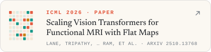

<picture><source media="(prefers-color-scheme: dark)" srcset="https://raw.githubusercontent.com/Manishram-ai/Manishram-ai/main/assets/header-dark.svg"></picture>

<a href="https://www.manishram.com"><picture><source media="(prefers-color-scheme: dark)" srcset="https://raw.githubusercontent.com/Manishram-ai/Manishram-ai/main/assets/pill-site-dark.svg"></picture></a>
<a href="https://parafield.ai/ideas"><picture><source media="(prefers-color-scheme: dark)" srcset="https://raw.githubusercontent.com/Manishram-ai/Manishram-ai/main/assets/pill-parafield-dark.svg"></picture></a>
<a href="https://www.linkedin.com/in/manishram-saravanan/"><picture><source media="(prefers-color-scheme: dark)" srcset="https://raw.githubusercontent.com/Manishram-ai/Manishram-ai/main/assets/pill-linkedin-dark.svg"></picture></a>

Hi, I'm Manish. I co-founded [Parafield](https://parafield.ai) and I'm its Chief Scientist. We make spatial audio for audiobooks and audio stories. I also work on machine learning for health: a foundation model for fMRI, DeepTracer’s protein diffusion model, medical language models, and the benchmarks and RL environments we test them with.

<picture><source media="(prefers-color-scheme: dark)" srcset="https://raw.githubusercontent.com/Manishram-ai/Manishram-ai/main/assets/banner-about-dark.svg"></picture>

- <picture><source media="(prefers-color-scheme: dark)" srcset="https://raw.githubusercontent.com/Manishram-ai/Manishram-ai/main/assets/icon-paper-dark.svg"></picture>&nbsp; Co-author of two ICML 2026 papers and one at NeurIPS 2026. The University of Washington gave me its Undergraduate Research Excellence Award for reaching ICML before graduating.

- <picture><source media="(prefers-color-scheme: dark)" srcset="https://raw.githubusercontent.com/Manishram-ai/Manishram-ai/main/assets/icon-patches-dark.svg"></picture>&nbsp; Contributed to [CortexMAE](https://arxiv.org/abs/2510.13768), an fMRI foundation model on Vision Transformers that decodes cognitive states in real time.

- <picture><source media="(prefers-color-scheme: dark)" srcset="https://raw.githubusercontent.com/Manishram-ai/Manishram-ai/main/assets/icon-check-dark.svg"></picture>&nbsp; Built an RL environment on [Prime Intellect](https://app.primeintellect.ai/dashboard/environments/manishram/medarc-k-qa) that cut medical LLM hallucinations by 20–24%, by checking every claim in an answer.

- <picture><source media="(prefers-color-scheme: dark)" srcset="https://raw.githubusercontent.com/Manishram-ai/Manishram-ai/main/assets/icon-mic-dark.svg"></picture>&nbsp; [Kosmos](https://github.com/Parafield-Official/kosmos): free, open-source software for narrators, with mastering, a teleprompter, and spelling and pronunciation checks. Our first customer uses it.

- <picture><source media="(prefers-color-scheme: dark)" srcset="https://raw.githubusercontent.com/Manishram-ai/Manishram-ai/main/assets/icon-helix-dark.svg"></picture>&nbsp; Led training and evaluation of DeepTracer’s protein diffusion model (IEEE BIBM 2026 workshop), and got UW’s Undergraduate Leadership and Service Award for it.

- <picture><source media="(prefers-color-scheme: dark)" srcset="https://raw.githubusercontent.com/Manishram-ai/Manishram-ai/main/assets/icon-merge-dark.svg"></picture>&nbsp; Pull requests to Swift, Turborepo, Vercel’s Chat SDK, Backstage, NASA’s F´ and AWS Powertools.

- <picture><source media="(prefers-color-scheme: dark)" srcset="https://raw.githubusercontent.com/Manishram-ai/Manishram-ai/main/assets/icon-trophy-dark.svg"></picture>&nbsp; In grade 9, part of a Guinness World Record: the most people taking an online programming lesson in 24 hours. Top 5% in India’s national STEM boards, twice.

<picture><source media="(prefers-color-scheme: dark)" srcset="https://raw.githubusercontent.com/Manishram-ai/Manishram-ai/main/assets/banner-papers-dark.svg"></picture>

<a href="https://arxiv.org/abs/2510.13768"><picture><source media="(prefers-color-scheme: dark)" srcset="https://raw.githubusercontent.com/Manishram-ai/Manishram-ai/main/assets/paper-cortexmae-dark.svg"></picture></a>
<a href="https://arxiv.org/abs/2605.01417"><picture><source media="(prefers-color-scheme: dark)" srcset="https://raw.githubusercontent.com/Manishram-ai/Manishram-ai/main/assets/paper-medmarks-dark.svg"></picture></a>

<picture><source media="(prefers-color-scheme: dark)" srcset="https://raw.githubusercontent.com/Manishram-ai/Manishram-ai/main/assets/banner-writing-dark.svg"></picture>

<picture><source media="(prefers-color-scheme: dark)" srcset="https://raw.githubusercontent.com/Manishram-ai/Manishram-ai/main/assets/player-dark.svg"></picture>

<a href="https://parafield.ai/ideas/head-to-head"><picture><source media="(prefers-color-scheme: dark)" srcset="https://raw.githubusercontent.com/Manishram-ai/Manishram-ai/main/assets/writing-1-dark.svg"></picture></a>
<a href="https://parafield.ai/ideas/narrators-ruler"><picture><source media="(prefers-color-scheme: dark)" srcset="https://raw.githubusercontent.com/Manishram-ai/Manishram-ai/main/assets/writing-2-dark.svg"></picture></a>
<a href="https://parafield.ai/ideas/space-buys-clarity"><picture><source media="(prefers-color-scheme: dark)" srcset="https://raw.githubusercontent.com/Manishram-ai/Manishram-ai/main/assets/writing-3-dark.svg"></picture></a>
<a href="https://parafield.ai/ideas/out-of-your-head"><picture><source media="(prefers-color-scheme: dark)" srcset="https://raw.githubusercontent.com/Manishram-ai/Manishram-ai/main/assets/writing-4-dark.svg"></picture></a>
<a href="https://www.manishram.com/research/healthgpt"><picture><source media="(prefers-color-scheme: dark)" srcset="https://raw.githubusercontent.com/Manishram-ai/Manishram-ai/main/assets/writing-5-dark.svg"></picture></a>
<a href="https://www.manishram.com/research/rl-environment"><picture><source media="(prefers-color-scheme: dark)" srcset="https://raw.githubusercontent.com/Manishram-ai/Manishram-ai/main/assets/writing-6-dark.svg"></picture></a>
<a href="https://www.manishram.com/research/grand-rounds"><picture><source media="(prefers-color-scheme: dark)" srcset="https://raw.githubusercontent.com/Manishram-ai/Manishram-ai/main/assets/writing-7-dark.svg"></picture></a>
<a href="https://www.manishram.com/research/fmri-foundation-model"><picture><source media="(prefers-color-scheme: dark)" srcset="https://raw.githubusercontent.com/Manishram-ai/Manishram-ai/main/assets/writing-8-dark.svg"></picture></a>

<picture><source media="(prefers-color-scheme: dark)" srcset="https://raw.githubusercontent.com/Manishram-ai/Manishram-ai/main/assets/banner-code-dark.svg"></picture>

<picture><source media="(prefers-color-scheme: dark)" srcset="https://raw.githubusercontent.com/Manishram-ai/Manishram-ai/main/assets/code-dark.svg"></picture>

<picture><source media="(prefers-color-scheme: dark)" srcset="https://raw.githubusercontent.com/Manishram-ai/Manishram-ai/main/assets/contrib-dark.svg"></picture>

<picture><source media="(prefers-color-scheme: dark)" srcset="https://raw.githubusercontent.com/Manishram-ai/Manishram-ai/main/assets/banner-tools-dark.svg"></picture>

<picture><source media="(prefers-color-scheme: dark)" srcset="https://skillicons.dev/icons?i=py%2Cpytorch%2Csklearn%2Ccpp%2Cts%2Cjs%2Creact%2Cnodejs%2Cvite%2Cswift%2Cdart%2Cflutter%2Caws%2Cdocker%2Cgithubactions%2Cgit%2Clinux%2Cbash%2Clatex&perline=10&theme=dark"></picture>
